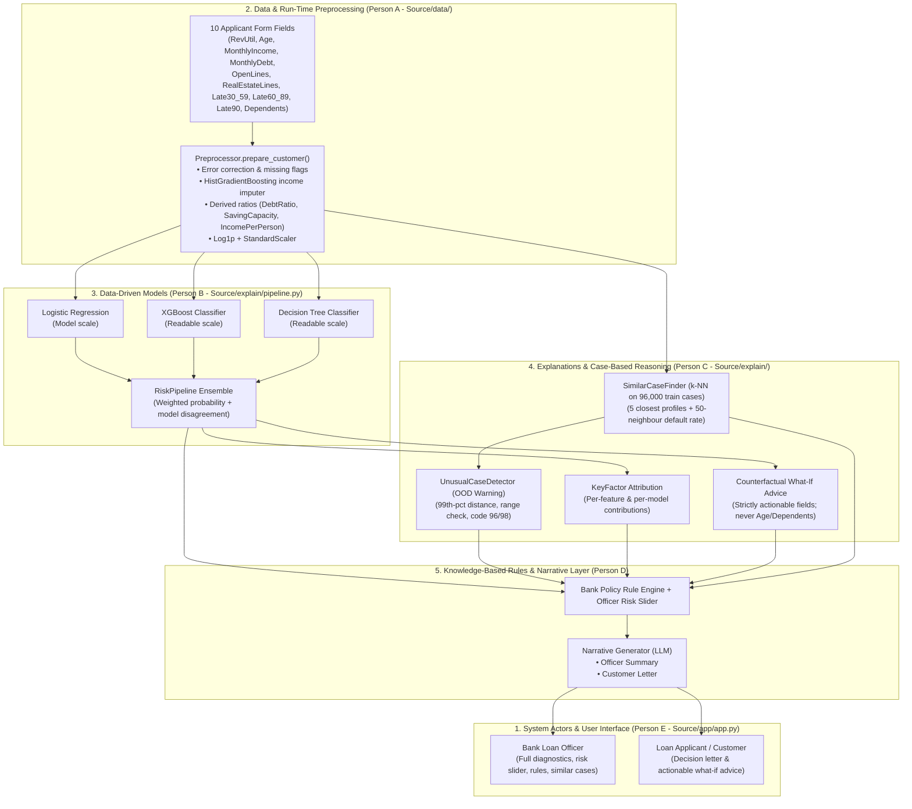

# PW3 — Credit Scoring IDSS: Architecture, Coordination, Gantt & Time Sheet (Person E)

This document covers the coordination and report sections managed by **Person E** for the final deliverable (`Documentation/` folder in the ZIP file required by `PracticalWork3IDSS.pdf`).

---

## 1. Functional Architecture of the IDSS Prototype (Deliverable `1.c`)

Our Intelligent Decision Support System combines **Data-Driven Models** (Logistic Regression, XGBoost, Decision Tree ensemble + $k$-NN similarity & OOD detection) with a **Knowledge-Based Component** (explicit bank policy rules, out-of-distribution safeguard, and actionable counterfactual constraints) and an **LLM / Narrative Layer** tailored to two distinct actors: the **Bank Loan Officer** and the **Loan Applicant (Customer)**.

---

## 2. Testing Use Cases (Deliverable `1.h` & Procedure Step 12)

All 4 testing use cases are pre-loaded in the Streamlit sidebar (`Source/app/use_cases.py`):

| Use Case | Applicant Profile | Target Behaviour | Expected Outcome |
| :--- | :--- | :--- | :--- |
| **UC1 — Low-risk applicant** | Age 44, Income \$6,800, Debt \$1,450 (21% DTI), RevUtil 18%, 0 late payments, 1 mortgage | Low predicted risk across all models, ordinary profile, no policy rule triggered | **APPROVE** |
| **UC2 — Borderline applicant** | Age 42, Income \$4,800, Debt \$1,850 (39% DTI), RevUtil 75%, one 30–59d late payment | Risk near the cut-off; counterfactual advice shows how lowering utilisation/debt reaches approval | **REVIEW** |
| **UC3 — High-risk applicant** | Age 33, Income \$3,100, Debt \$2,600 (84% DTI), RevUtil 115%, two 90+d late payments | High default probability + repeated 90+ day delinquencies and over-limit revolving credit | **REJECT** |
| **UC4 — Unusual profile** | Age 20, Income \$2,500, Debt \$750, RevUtil 15%, 0 late payments, **12 mortgages & 18 open lines** | `UnusualCaseDetector` flags `outside_observed_range` & `far_from_past_applicants` | **REVIEW** |

---

## 3. Tasks Assignment & Team Responsibilities (Deliverable `1.l`)

| Team Member | Role & Scope | Concrete Deliverables & Python Modules |
| :--- | :--- | :--- |
| **Person A** | **Data & Fairness** | • EDA & cleaning rules (`notebooks/EDA.ipynb`, `Source/data/preprocessing.py`) • Fixed stratified 96k/24k/30k split (`Source/data/build_dataset.py`) • Fairness check across age groups |
| **Person B** | **Predictive Models** | • Training & tuning of Logistic Regression, XGBoost, and Decision Tree • Model combination (`RiskPipeline` in `Source/explain/pipeline.py`) • Evaluation metrics including false approvals and false rejections |
| **Person C** | **Explanations & CBR** | • Shared explanation data types & field metadata (`Source/explain/types.py`, `features.py`) • Key factor attribution (`KeyFactor`) & customer what-if advice (`AdviceItem`) • Historical k-NN search (`Source/explain/similar.py`) & unusual-case warning (`Source/explain/unusual.py`) |
| **Person D** | **Decision Rules & LLM** | • Final recommendation (`approve` / `review` / `reject`), risk slider & bank rules • LLM generation for the officer summary and customer letter |
| **Person E** | **App, Integration & Coordination** | • Unified `CaseResult` contract (`Source/app/case_result.py`) & orchestrator (`Source/app/orchestrator.py`) • Streamlit UI (`Source/app/app.py`) & testing Use Cases (`Source/app/use_cases.py`) • Project planning, Gantt diagram, time sheet, 3–5 min Demo video (`Demo/`), and final ZIP (`README.txt`) |

---

## 4. Gantt Diagram & Project Planning Template (Deliverable `1.k`)

> *To be filled with the team's actual schedule dates.*

| Task ID | Task Description | Owner | Start Date | End Date | Status |
| :--- | :--- | :---: | :---: | :---: | :---: |
| **T1** | Problem definition, dataset selection & actor specification | All | TBD | TBD | TBD |
| **T2** | Exploratory Data Analysis, imputation & feature engineering | Person A | TBD | TBD | TBD |
| **T3** | Shared train/val/test split & `Preprocessor` runtime pipeline | Person A | TBD | TBD | TBD |
| **T4** | Training & combination of LogReg, XGBoost & Decision Tree | Person B | TBD | TBD | TBD |
| **T5** | Model evaluation (wrong approvals/rejections) & age fairness check | Person B, A | TBD | TBD | TBD |
| **T6** | Similar-cases search & Unusual-applicant warning | Person C | TBD | TBD | TBD |
| **T7** | Key factors attribution & what-if customer advice | Person C | TBD | TBD | TBD |
| **T8** | Bank rules, risk slider & LLM officer summary / customer letter | Person D | TBD | TBD | TBD |
| **T9** | Streamlit app, module integration & testing use cases | Person E | TBD | TBD | TBD |
| **T10** | Report, presentation slides, demo video & final ZIP | All (coord. E) | TBD | TBD | TBD |

---

## 5. Time Sheet & Global Accounting Template (Deliverable `1.m`)

> *Each team member fills in their actual hours spent per task before the final submission.*

| Task | Person A (Data) | Person B (Models) | Person C (Explain) | Person D (Decision/LLM) | Person E (App/Coord) | **Total Task Hours** |
| :--- | :---: | :---: | :---: | :---: | :---: | :---: |
| **T1. Problem & Architecture Design** | __ h | __ h | __ h | __ h | __ h | **__ h** |
| **T2. EDA & Data Cleaning** | __ h | __ h | __ h | __ h | __ h | **__ h** |
| **T3. Runtime Preprocessing & Splits** | __ h | __ h | __ h | __ h | __ h | **__ h** |
| **T4. Model Training & Combination** | __ h | __ h | __ h | __ h | __ h | **__ h** |
| **T5. Model Evaluation & Age Fairness** | __ h | __ h | __ h | __ h | __ h | **__ h** |
| **T6. Similar Cases & Unusual Warning** | __ h | __ h | __ h | __ h | __ h | **__ h** |
| **T7. Key Factors & What-If Advice** | __ h | __ h | __ h | __ h | __ h | **__ h** |
| **T8. Bank Rules, Risk Slider & LLM** | __ h | __ h | __ h | __ h | __ h | **__ h** |
| **T9. Streamlit App & Integration** | __ h | __ h | __ h | __ h | __ h | **__ h** |
| **T10. Report, Demo Video, Slides & ZIP** | __ h | __ h | __ h | __ h | __ h | **__ h** |
| **Global Accounting per Member** | **__ h** | **__ h** | **__ h** | **__ h** | **__ h** | **__ h** |

---

## 6. Final ZIP Deliverable Checklist (PW3 Page 2–3)

Label the final archive: `PW3-IDSS-YearCourse-T#NumberOfTeamwork-TitleOfWork.zip`

- [ ] `Documentation/` — Final PDF report containing sections `1.a` through `1.m`.
- [ ] `Data/` — Raw dataset (`GiveMeSomeCredit-training.csv`) and prepared train/val/test tables + `preprocessing.joblib`.
- [ ] `Models/` — Saved models (`logreg`, `xgboost`, `tree` / visualizable decision rules) and `Models/explain/unusual_detector.json`.
- [ ] `Source/` — Complete Python package (`Source/data/`, `Source/explain/`, `Source/app/`, `Source/tests/`).
- [ ] `Demo/` — 3–5 minute video demonstrating the UI across the testing use cases.
- [ ] `Presentation/` — Public presentation slides (max 15 slides), explicitly including:
  - Slide 1: Title, group number, member names, date.
  - Summary slides of the report.
  - Slide on the **actors interacting with the IDSS** (Bank Loan Officer & Loan Applicant).
  - Slide on the **functional architecture of the IDSS**.
  - Slide describing the **testing use cases**.
- [ ] `README.txt` — Root text file explaining the structure and how to run the prototype.
