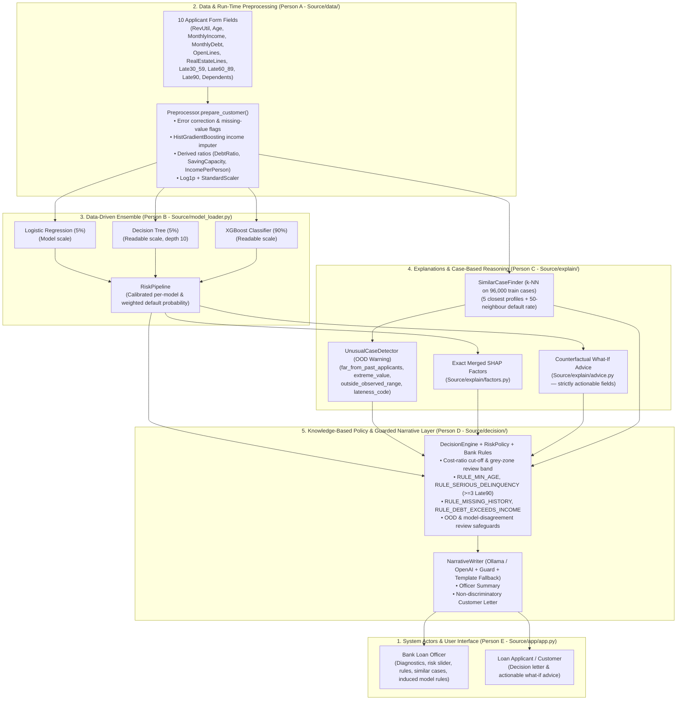

# PW3 — Credit Scoring IDSS: Architecture, Coordination, Gantt & Time Sheet (Person E)

This document covers the coordination and report sections managed by **Person E** for the final deliverable (`Documentation/` folder in the ZIP file required by `PracticalWork3IDSS.pdf`).

---

## 1. Functional Architecture of the IDSS Prototype (Deliverable `1.c`)

Our Intelligent Decision Support System combines **Data-Driven Models** (5% Logistic Regression + 5% Decision Tree + 90% XGBoost calibrated ensemble, exact merged SHAP attributions, and $k$-NN case-based reasoning) with **Model-Driven / Knowledge-Based Components** (explicit bank policy rules, cost-ratio threshold policy, out-of-distribution safeguard, and actionable counterfactual constraints) and a **Guarded LLM / Template Narrative Layer** serving two actors: the **Bank Loan Officer** and the **Loan Applicant (Customer)**.

---

## 2. Testing Use Cases (Deliverable `1.h` & Procedure Step 12)

All 4 testing use cases are pre-loaded in the Streamlit sidebar (`Source/app/use_cases.py`):

| Use Case | Applicant Profile | Active IDSS Mechanisms | Expected Outcome |
| :--- | :--- | :--- | :--- |
| **UC1 — Low-risk applicant** | Age 44, Income \$6,800, Debt \$1,450 (21% DTI), RevUtil 18%, 0 late payments, 1 mortgage | Low predicted risk (~1.6%) across all 3 models, 0% default in 50 nearest neighbours, no rule triggered | **APPROVE** |
| **UC2 — Borderline applicant** | Age 42, Income \$4,800, Debt \$1,850 (39% DTI), RevUtil 75%, one 30–59d late payment | Risk (~12.4%) inside the grey zone around the 12% cut-off; counterfactual advice identifies changes that pass approval | **REVIEW** |
| **UC3 — High-risk applicant** | Age 33, Income \$3,100, Debt \$2,600 (84% DTI), RevUtil 115%, two 90+d late payments | High ensemble default risk (~78%) due to over-limit credit cards and serious delinquencies | **REJECT** |
| **UC4 — Unusual profile** | Age 20, Income \$2,500, Debt \$750, RevUtil 15%, 0 late payments, **12 mortgages & 18 open lines** | `UnusualCaseDetector` flags `outside_observed_range`, `far_from_past_applicants` & `extreme_value`, plus model disagreement | **REVIEW** |

---

## 3. Tasks Assignment & Team Responsibilities (Deliverable `1.l`)

| Team Member | Role & Scope | Concrete Deliverables & Python Modules |
| :--- | :--- | :--- |
| **Person A** | **Data & Fairness** | • EDA & cleaning rules (`notebooks/EDA.ipynb`, `Source/data/preprocessing.py`) • Fixed stratified 96k/24k/30k split (`Source/data/build_dataset.py`) • Fairness evaluation across age groups |
| **Person B** | **Predictive Models** | • Training, tuning & evaluation of Logistic Regression, Decision Tree, and XGBoost (`notebooks/model_training.ipynb`, `Source/train_models.py`) • Weighted ensemble (5% / 5% / 90%) & model loader (`Source/model_loader.py`, `Models/`) |
| **Person C** | **Explanations & CBR** | • Shared types & field metadata (`Source/explain/types.py`, `features.py`, `pipeline.py`) • Exact merged SHAP factors (`factors.py`) & counterfactual advice (`advice.py`) • Historical k-NN search (`similar.py`), unusual-case warning (`unusual.py`) & `explain_case()` (`case.py`) |
| **Person D** | **Decision Rules & LLM** | • Cost-ratio risk slider (`Source/decision/policy.py`), bank rules (`rules.py`), decision engine (`engine.py`, `service.py`, `evaluate.py`) • Guarded LLM / template narrative writer (`Source/decision/narrative/`) |
| **Person E** | **App, Integration & Coordination** | • Unified `CaseResult` (`Source/app/case_result.py`), orchestrator (`orchestrator.py`), use cases (`use_cases.py`), readable model exporter (`Source/export_readable_models.py`) • 4-tab Streamlit UI (`Source/app/app.py`) & ZIP packager (`Source/build_deliverable_zip.py`) • Planning, Gantt diagram, time sheet, 3–5 min Demo video (`Demo/`), slides (`Presentation/`), and `README.txt` |

---

## 4. Gantt Diagram & Project Planning Template (Deliverable `1.k`)

> *To be filled with the team's actual schedule dates.*

| Task ID | Task Description | Owner | Start Date | End Date | Status |
| :--- | :--- | :---: | :---: | :---: | :---: |
| **T1** | Problem definition, dataset selection & actor specification | All | TBD | TBD | TBD |
| **T2** | Exploratory Data Analysis, imputation & feature engineering | Person A | TBD | TBD | TBD |
| **T3** | Shared train/val/test split & `Preprocessor` runtime pipeline | Person A | TBD | TBD | TBD |
| **T4** | Training & combination of LogReg, Decision Tree & XGBoost | Person B | TBD | TBD | TBD |
| **T5** | Model evaluation (wrong approvals/rejections) & age fairness check | Person B, A | TBD | TBD | TBD |
| **T6** | Similar-cases search & Unusual-applicant warning | Person C | TBD | TBD | TBD |
| **T7** | Exact SHAP key factors & what-if customer advice | Person C | TBD | TBD | TBD |
| **T8** | Bank rules, cost-ratio risk slider & guarded LLM narratives | Person D | TBD | TBD | TBD |
| **T9** | Streamlit app, module integration, readable models & testing use cases | Person E | TBD | TBD | TBD |
| **T10** | Report, presentation slides, demo video & final ZIP | All (coord. E) | TBD | TBD | TBD |

---

## 5. Time Sheet & Global Accounting Template (Deliverable `1.m`)

> *Each team member fills in their actual hours spent per task before the final submission.*

| Task | Person A (Data) | Person B (Models) | Person C (Explain) | Person D (Decision/LLM) | Person E (App/Coord) | **Total Task Hours** |
| :--- | :---: | :---: | :---: | :---: | :---: | :---: |
| **T1. Problem & Architecture Design** | __ h | __ h | __ h | __ h | __ h | **__ h** |
| **T2. EDA & Data Cleaning** | __ h | __ h | __ h | __ h | __ h | **__ h** |
| **T3. Runtime Preprocessing & Splits** | __ h | __ h | __ h | __ h | __ h | **__ h** |
| **T4. Model Training & Combination** | __ h | __ h | __ h | __ h | __ h | **__ h** |
| **T5. Model Evaluation & Age Fairness** | __ h | __ h | __ h | __ h | __ h | **__ h** |
| **T6. Similar Cases & Unusual Warning** | __ h | __ h | __ h | __ h | __ h | **__ h** |
| **T7. Key Factors & What-If Advice** | __ h | __ h | __ h | __ h | __ h | **__ h** |
| **T8. Bank Rules, Risk Slider & LLM** | __ h | __ h | __ h | __ h | __ h | **__ h** |
| **T9. Streamlit App & Integration** | __ h | __ h | __ h | __ h | __ h | **__ h** |
| **T10. Report, Demo Video, Slides & ZIP** | __ h | __ h | __ h | __ h | __ h | **__ h** |
| **Global Accounting per Member** | **__ h** | **__ h** | **__ h** | **__ h** | **__ h** | **__ h** |

---

## 6. Final ZIP Deliverable Checklist (PW3 Page 2–3)

Generate the archive with `python -m Source.build_deliverable_zip --year 2026-2027 --team <N> --title <Title>`:

- [ ] `Documentation/` — Final PDF report containing sections `1.a` through `1.m`.
- [ ] `Data/` — Raw dataset (`GiveMeSomeCredit-training.csv`) and preprocessed train/val/test splits + `preprocessing.joblib`.
- [ ] `Models/` — Saved models (`.joblib`), `ensemble_config.json`, readable summaries (`logistic_regression_weights.json`, `xgboost_feature_importance.json`), and `explain/unusual_detector.json`.
- [ ] `Source/` — Complete Python package (`data/`, `explain/`, `decision/`, `app/`, `tests/`, `train_models.py`, `model_loader.py`, `export_readable_models.py`, `build_deliverable_zip.py`, `notebooks/`).
- [ ] `Demo/` — 3–5 minute video demonstrating the UI across the testing use cases.
- [ ] `Presentation/` — Public presentation slides (max 15 slides), explicitly including:
  - Slide 1: Title, group number, member names, date.
  - Summary slides of the report.
  - Slide on the **actors interacting with the IDSS** (Bank Loan Officer & Loan Applicant).
  - Slide on the **functional architecture of the IDSS**.
  - Slide describing the **testing use cases**.
- [ ] `README.txt` — Root text file explaining the structure and how to run the prototype.
